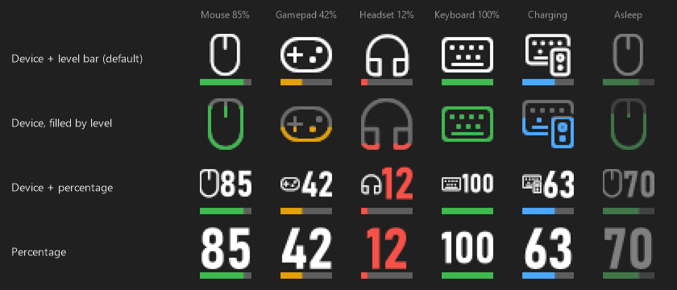

# Battery Monitor

A tiny Windows tray app that shows the battery level of your wireless mice, keyboards, controllers and headsets right
on the taskbar. No vendor software needed.



The level bar is **green** from 50%, **amber** from 20%, **red** below 20%, and **blue** while charging. A faded icon
means the device is asleep (e.g. an idle mouse) and shows its last known level.

- **The icon shows the lowest battery** among your devices (the one that needs attention), so one glance is enough.
  Prefer a specific device? Click the icon → **Icon shows** → pick it.
- **Hover** the icon: every device with its exact percentage and charging state.
- **Click** (left or right): all devices, *Icon shows*, *Icon style*, *One icon per device*, *Refresh now*,
  *Start with Windows*, *Exit*.
- **Icon style** (in the menu):
  - *Device + level bar* (default): big device symbol, level shown by the coloured bar.
  - *Device, filled by level*: the symbol itself is coloured from the bottom up to the battery level.
  - *Device + percentage*: small symbol next to the number.
  - *Percentage*: just the number, as large as possible.

  At 100% display scaling a tray icon is only 16 px, so the symbol and the number can't both be big; pick what you
  prefer. The exact percentage is always in the tooltip.
- **One icon per device** (in the menu) switches to a separate icon for each device instead.
- A notification appears when any device drops to 15% (once, re-armed after charging).
- Values refresh every 60 s and right after a device connects or disconnects.
- Adapts to light/dark taskbars and any display scaling.
- **Private:** the app never connects to the internet and collects nothing. It only talks to your devices and keeps
  its menu choices in the registry.

## Download & install

1. Go to **[Releases](../../releases/latest)** and download `BatteryMonitor-<version>-x64.exe`
   (or `-arm64.exe` for ARM laptops such as Snapdragon / Surface Pro X). It's a single ~0.6 MB file. There's no
   installer and nothing else to install.
2. Put it somewhere permanent (e.g. `Documents\BatteryMonitor\`) and run it.
3. **Windows SmartScreen will say "Windows protected your PC"** because the app isn't code-signed. Click
   **More info → Run anyway**. You only need to do this once.
4. **Windows 11 hides new tray icons** in the overflow menu (the **^** next to the clock). Drag the battery icon from
   there onto the taskbar, or turn it on under *Settings › Personalization › Taskbar › Other system tray icons*.
5. Click the battery icon → **Start with Windows** to have it start automatically.

To update, exit the app (click the icon → *Exit*), replace the exe with the new one, and run it again.
To uninstall, untick *Start with Windows*, exit, and delete the exe. (Menu choices are kept in the registry under
`HKCU\Software\BatteryMonitor`; delete that key too if you want no trace left.)

Requires Windows 10 or 11.

## Supported devices

✅ = confirmed on real hardware. Everything else is implemented from the device's documented protocol but hasn't been
tried with this app yet. If yours doesn't show up, please [open an issue](#something-not-working) with a `--probe`
log: that's what's needed to fix it.

**Razer**: wireless mice and keyboards, on the HyperSpeed dongle or the cable
- Any model that uses Razer's standard control protocol, which covers most recent ones. ✅ Viper V3 Pro

**Xbox and other XInput controllers**: over Bluetooth or the Xbox Wireless Adapter
- Xbox One and Xbox Series controllers. ✅ Xbox One S controller (Bluetooth)
- Other wireless controllers that present themselves as Xbox controllers
- Xbox controllers only report four levels, so the icon shows 10, 40, 70 or 100%.

**Sony**: over USB or Bluetooth
- DualSense, DualSense Edge

**Logitech**
- Mice and keyboards on a LIGHTSPEED, Unifying or Bolt receiver, or on the cable, that use Logitech's HID++ 2.0
  protocol (most models from the last decade, e.g. G PRO X SUPERLIGHT, MX Master 3S). Each receiver slot shows up as
  its own device, with the name the device reports.
- Headsets: G533, G535, G633, G635, G733, G933, G935, G PRO / G PRO X Wireless,
  G PRO X 2 LIGHTSPEED, G522 LIGHTSPEED, G PRO X 3 LIGHTSPEED

**SteelSeries headsets**
- Arctis 1 Wireless (incl. Xbox edition), Arctis 7X, Arctis 7P
- Arctis 7 (2017 and 2019), Arctis Pro (2019), Arctis Pro Wireless, Arctis 9 Wireless
- Arctis 7+ (incl. PS5, Xbox and Destiny editions)
- Arctis Nova 3P / 3X Wireless, Arctis Nova 5 / 5X
- Arctis Nova 7 / 7X / 7P (all revisions, incl. Gen 2, Diablo IV and WoW editions)
- Arctis Nova Pro Wireless / Nova Pro Wireless X
- Arctis GameBuds

**HyperX headsets**
- Cloud II Wireless (HP-era models), Cloud Alpha Wireless, Cloud Alpha 2 Wireless, Cloud Flight

**Corsair**
- VOID-family wireless headsets (VOID / VOID PRO / VOID ELITE Wireless, HS70 Wireless)
- Virtuoso RGB Wireless XT / SE, VOID Wireless V2, Virtuoso MAX Wireless, HS80 MAX Wireless
- Experimental: other recent Corsair wireless devices, such as Slipstream mice and keyboards

**Ajazz**: over the 2.4 GHz receiver or the cable
- AJ179 / AJ179P (dual mode and PAW3950 versions)
- AJ159P, PAW3950 version ("AJ159P-3950")
- Tip: these are the Ajazz mice whose official web configurator is *ajazz.xcgaming.net*. Other Ajazz models use
  different protocols, see *Not supported*.

**Bluetooth devices of any brand**
- Anything whose battery level Windows already shows in *Settings › Bluetooth & devices*: many earbuds and
  headphones, and most Bluetooth mice and keyboards.

### Not supported

- **NuPhy keyboards** over USB or the 2.4 GHz dongle: the firmware tracks the battery but never sends it to the PC
  (checked against the community QMK firmware). In **Bluetooth mode** a NuPhy keyboard can work through the Bluetooth
  support above, if Windows shows its battery in Settings.
- **Razer BlackShark V2 Pro (2023)** on its 2.4 GHz dongle: the dongle rejects the commands that work for the
  PlayStation edition (tested). Paired over **Bluetooth** it can work through the Bluetooth support above.
  Other Razer headsets that don't use Razer's standard control protocol aren't supported either.
- **Logitech ASTRO A50** (uses its own protocol). G PRO X 2 LIGHTSPEED units on very old firmware: update the headset
  in G HUB first.
- **HyperX Cloud II Wireless** (Kingston-branded, `0951:1718`), **HyperX Cloud III**.
- **Other Ajazz mice** (e.g. AJ159 PRO / APEX, AJ159P MC PRO, AJ159 V2, AJ199): they use other chips and protocols.
  Over **Bluetooth** they can work through the Bluetooth support above, if Windows shows their battery in Settings.
- Wired headsets: they have no battery.

<details>
<summary>How each device is read (for contributors)</summary>

| Devices | Protocol |
|---|---|
| Razer mice and keyboards | Razer HID feature report (90 bytes): class `0x07`, command `0x80` level / `0x84` charging. Status `0x04` = device asleep |
| Xbox / XInput controllers | `XInputGetBatteryInformation` (4 coarse levels) |
| DualSense / Edge | Status byte in the input report (USB report `0x01` byte 53, Bluetooth report `0x31` byte 54) |
| Logitech mice and keyboards | HID++ 2.0: the root feature locates `0x1004` unified battery, `0x1000` battery status or `0x1001` battery voltage |
| Logitech G533 … G PRO X | HID++ `0x1F20` ADC voltage + per-model discharge curve |
| Logitech PRO X 2 / G522 / PRO X 3 | "Centurion" frames; headset feature `0x0104` reached through the dongle's bridge feature `0x0003` |
| SteelSeries, HyperX | Per-model status requests on the vendor HID interface |
| Corsair VOID family | `0xC9 0x64` request, status input report `0x64` |
| Corsair Bragi | Property `0x0F` (level, tenths of a percent) and `0x10` (charge state) |
| Ajazz AJ179, AJ159P-3950 | Command `0x10` (device info) on interface 2: model ID bytes 4–7, charging byte 12, battery byte 13, connected byte 14 |
| Bluetooth | Windows' `DEVPKEY_Bluetooth_Battery` device property |

</details>

## Something not working?

Open an [issue](../../issues/new/choose) and include the diagnostic output. With the device switched on, open
PowerShell in the folder with the exe and run:

```powershell
.\BatteryMonitor-<version>-x64.exe --probe --verbose | Out-File probe.txt   # what each reader sees, with raw traffic
.\BatteryMonitor-<version>-x64.exe --list-hid | Out-File hid.txt            # every HID device (VID:PID, usage, name)
```

(The `| Out-File` matters: the exe is a tray app, so without it PowerShell doesn't wait for the output.)

Common cases:
- **Mouse missing or faded:** wireless mice sleep after a few idle minutes and can't be read then. Move the mouse, and
  it updates on the next refresh (within a minute).
- **Controller or headset missing:** it has to be switched on and connected. A paired device that is off can't be read.
- **DualSense over Bluetooth:** the pad starts in a basic report mode with no battery data. The app switches it to
  full reports (as Steam does), and it stays that way until the pad disconnects. Very old DirectInput-only games that
  expect the basic report may misread input until you reconnect the pad.
- **Antivirus flags the exe:** unsigned single-file apps that read USB devices sometimes trigger false positives.
  Please report it in an issue.

## Building from source

Requires [Rust](https://rustup.rs) and Visual Studio (or Build Tools) with the **C++ workload and a Windows SDK**.
The Rust version is pinned in `rust-toolchain.toml`; rustup installs it automatically.

```powershell
cargo build --release                 # -> target\release\BatteryMonitor.exe
cargo run --release -- --probe        # diagnostics from source
```

If the build fails with ``linker `link.exe` not found``, Rust didn't detect your Visual Studio version. Use
`tools\cargo-vs.cmd build --release`, which runs cargo inside the Visual Studio developer environment.

### Before sending a pull request

CI (`.github/workflows/ci.yml`) runs these on every push and pull request; run them locally first:

```powershell
cargo fmt --all                                            # formatting (rules in rustfmt.toml)
cargo clippy --release --locked --all-targets -- -D warnings
cargo test --release --locked
```

Device protocols can't be unit-tested without the hardware, so for reader changes also include `--probe --verbose`
output from a real device.

### Making a release

The version lives in `Cargo.toml` and follows [Semantic Versioning](https://semver.org/). To release:

1. Bump `version` in `Cargo.toml` (then `cargo build` to update `Cargo.lock`).
2. Move the *Unreleased* notes in `CHANGELOG.md` into a new `## [x.y.z] - date` section.
3. Commit, then tag and push the tag:

   ```powershell
   git tag v0.1.0
   git push origin v0.1.0
   ```

GitHub Actions (`.github/workflows/release.yml`) then runs the checks, builds x64 and ARM64, and publishes the release
with both exes, their SHA-256 checksums and the changelog section as release notes. It refuses a tag that doesn't
match `Cargo.toml` or has no changelog section. To test the build without publishing, run the *Release* workflow
manually from the Actions tab: the exes are attached to the run instead.

The app icon (`assets/app.ico`) is generated by `python tools/make_icon.py`.

### Adding a device

Implement `Provider` (`src/devices/`) and register it in `devices::all()`, or, for a simple request/response
protocol, add a `Spec` to one of the tables in `src/devices/headsets/`. `hid::Channel` handles output/input-report
request/response using hidapi's byte conventions, so protocol notes from hidapi-based projects can be copied with
their offsets unchanged. Use `--list-hid` to find the right collection.

## Credits

The device protocols (command bytes, report layouts, product IDs) were documented by these open-source projects.
This app is an independent implementation in Rust. No code was copied, but it would not exist without their
reverse-engineering work:

- [HeadsetControl](https://github.com/Sapd/HeadsetControl): SteelSeries, HyperX, Corsair and Logitech headsets
- [Solaar](https://github.com/pwr-Solaar/Solaar): Logitech HID++ 2.0
- [OpenRazer](https://github.com/openrazer/openrazer): Razer protocol
- [ckb-next](https://github.com/ckb-next/ckb-next): Corsair Bragi
- [aj179-linux](https://github.com/Rockeyxx/aj179-linux): Ajazz AJ179 (and with it the AJ159P-3950, which shares its
  protocol per Ajazz's own web configurator)
- Linux `hid-playstation` driver: DualSense report layout

## License

Copyright (C) 2026 RobertMRR

This program is free software: you can redistribute it and/or modify it under the terms of the GNU General Public
License as published by the Free Software Foundation, either version 3 of the License, or (at your option) any later
version. See [LICENSE](LICENSE).
